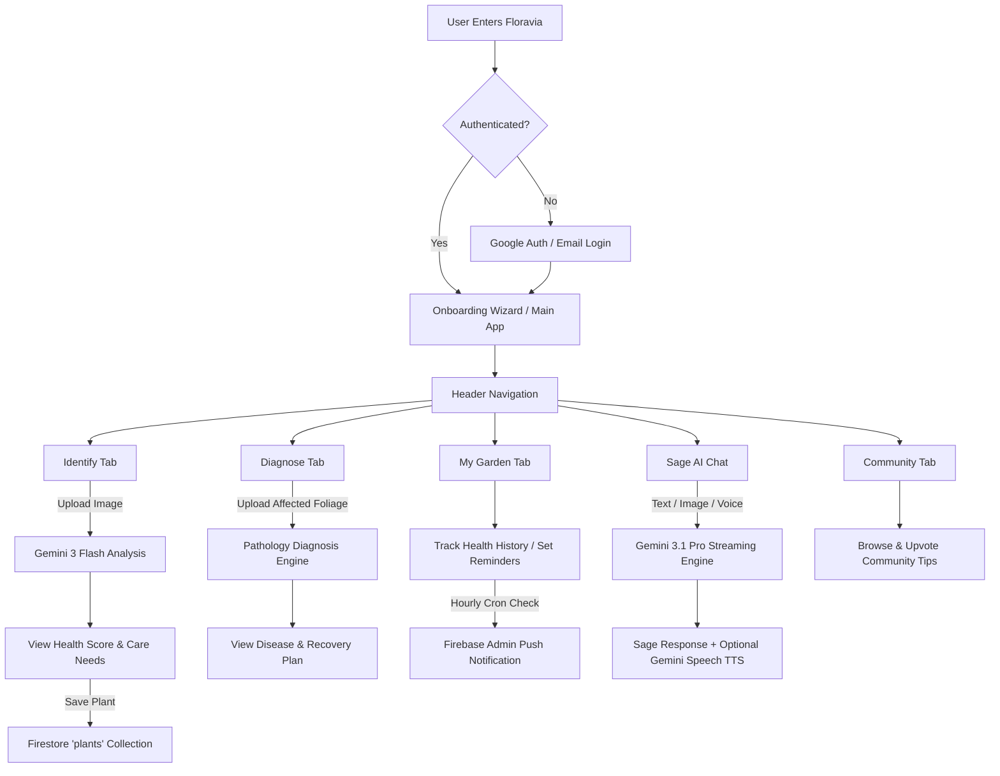

# Floravia — The AI-Powered Plant Intelligence Platform

[](https://www.typescriptlang.org/)
[](https://react.dev/)
[](https://vitejs.dev/)
[](https://tailwindcss.com/)
[](https://expressjs.com/)
[](https://firebase.google.com/)
[](https://ai.google.dev/)
[](LICENSE)

Floravia is a full-stack, enterprise-grade botanical intelligence platform designed to bridge plant science with artificial intelligence. By integrating multimodal Google Gemini models (`gemini-3-flash-preview`, `gemini-3.1-pro-preview`, and `gemini-3.1-flash-tts-preview`) with real-time weather analytics and longitudinal health tracking, Floravia provides instant species identification, pathological leaf diagnosis, conversational AI guidance ("Sage"), localized watering orchestration, and cross-device synchronization via Cloud Firestore.

---

## 📸 Hero Demo & Gallery

The platform features an ultra-modern, glassmorphism UI designed for high visual contrast and dark-mode comfort. Below is an overview of the live application interface:

### Interface Overview

| Application Dashboard | Species Identification |
| :---: | :---: |
| .png) |  |
| *Bioluminescent overview dashboard featuring active tab navigation, weather integration, and care protocols.* | *Multimodal image upload providing species identification, health scores, and predicted needs.* |

| Pathology & Disease Diagnosis | My Garden Collection |
| :---: | :---: |
|  |  |
| *Pathological scanner identifying leaf diseases, severity levels, and clinical treatment instructions.* | *Personal botanical library tracking individual plant health scores, care reminders, and activity logs.* |

| Sage AI Chatbot & Voice Mode | Community Knowledge & Profile |
| :---: | :---: |
|  |  |
| *Interactive streaming AI chatbot powered by Gemini 3.1 Pro with real-time text-to-speech audio delivery.* | *Crowdsourced botanical care protocols, community upvoting, and personalized gardener profile settings.* |

---

## 🎯 Project Overview

### What Problem It Solves
Houseplant mortality is often driven by improper watering schedules, unrecognized fungal or parasitic infections, and generalized care advice that ignores micro-climates. Traditional plant identification apps provide static encyclopedia entries without considering local humidity, ambient temperature, or historical plant stress.

### Who It's For
* **Home Gardeners & Urban Botanists**: Seeking automated watering schedules, disease diagnosis, and centralized tracking for indoor/outdoor plants.
* **Horticultural Enthusiasts**: Requiring deep technical insights (e.g., stomatal conductance, turgor pressure, photoperiodism) tailored to their experience level.
* **Plant Collectors**: Who need longitudinal health monitoring, historical care logs, and automated Web Push notification reminders.

### Why It Exists
Floravia combines vision AI with real-time environmental context and persistent state management to transform reactive plant care into a proactive, data-driven discipline.

---

## ✨ Key Features

### 1. Multimodal Plant Identification (`gemini-3-flash-preview`)
* **Instant Species Detection**: Identifies plant species from uploaded images or camera captures with precision confidence metrics.
* **Biometric Health Metrics**: Evaluates hydration levels, disease risk, stress levels, and assigns a 0–100 Health Score alongside a creative botanical "Mood".
* **Predictive Needs**: Automatically generates tailored requirements for watering, lighting, and fertilizing.

### 2. Pathological Disease Diagnosis (`gemini-3-flash-preview`)
* **Foliage Lesion Scanning**: Detects leaf necrosis, chlorosis, fungal rusts, and pest damage from high-resolution foliage scans.
* **Clinical Treatment Plans**: Outlines actionable, step-by-step recovery protocols formatted in clear markdown.
* **Severity Grading**: Categorizes disease severity into Low, Medium, High, or Severe states.

### 3. Sage: Streaming Botanical AI & Voice Assistant (`gemini-3.1-pro-preview` & `gemini-3.1-flash-tts-preview`)
* **Longitudinal Memory**: Integrates user garden history, preferences, and past chat context directly into the AI system prompt.
* **Real-Time Streaming Responses**: Streams responses via `@google/genai` `sendMessageStream` with semantic highlight formatting (`**key insight**`).
* **Phonetic Voice Synthesis**: Generates natural speech using the `gemini-3.1-flash-tts-preview` model and Web Audio API for interactive hands-free sessions.
* **Multi-Thread Management**: Supports creating, switching, and deleting distinct chat threads stored in Cloud Firestore.

### 4. My Garden & Care Orchestration
* **Personal Botanical Library**: Saves identified plants with health scores, custom nicknames, and predicted care schedules.
* **Health History & Recharts**: Plots longitudinal health trends over time using interactive Recharts line charts.
* **Reminders & Cron Dispatch**: Configures custom watering, fertilizing, and pruning reminders backed by server-side `node-cron` push tasks.

### 5. Localized Weather Intelligence (OpenWeatherMap API)
* **Micro-Climate Analysis**: Fetches real-time temperature, humidity, and condition metrics using browser Geolocation or coordinates.
* **Predictive Hydration Advice**: Adjusts watering recommendations based on heatwaves, high humidity, or precipitation warnings.

### 6. Community Knowledge Exchange
* **Crowdsourced Care Protocols**: Users share, filter, and upvote community gardening tips categorized by Houseplants, Pests, Watering, and Sunlight.

---

## 🔄 User Journey



---

## 🏗️ Architecture & Data Flow

Floravia uses a full-stack architecture with a React 19 single-page application frontend served through Vite development middleware or an Express Node.js production server.

### System Architecture Diagram

```
┌─────────────────────────────────────────────────────────────────────────────┐
│                              CLIENT LAYER                                   │
│  React 19 (Vite SPA) · TypeScript 5.8 · Tailwind CSS 4 · Motion             │
│  Recharts · Lucide React · Web Audio API · Service Worker (Web Push)        │
└──────────────────────────────────────┬──────────────────────────────────────┘
                                       │ HTTPS / WebSockets / gRPC
┌──────────────────────────────────────▼──────────────────────────────────────┐
│                        SERVER & BACKEND LAYER                               │
│  Express 4.21 (Node.js Container Runtime)                                   │
│  · GET /api/health                          · GET /firebase-messaging-sw.js │
│  · Firebase Admin SDK (Cloud Messaging)     · node-cron (Hourly Reminders)  │
└───────────────────┬─────────────────────────────────────┬───────────────────┘
                    │                                     │
┌───────────────────▼──────────────────┐       ┌──────────▼───────────────────┐
│           GOOGLE GEMINI AI           │       │       FIREBASE BACKEND       │
│  @google/genai SDK                   │       │  Firebase Authentication     │
│  · gemini-3-flash-preview            │       │  Cloud Firestore Database    │
│  · gemini-3.1-pro-preview (Stream)   │       │  Firebase Cloud Messaging    │
│  · gemini-3.1-flash-tts-preview      │       └──────────────────────────────┘
└──────────────────────────────────────┘
```

---

## 🛠️ Technology Stack

| Technology | Category | Purpose & Reason for Choice |
| :--- | :--- | :--- |
| **React 19** | Frontend Framework | High-performance UI rendering with modern concurrent features and declarative state. |
| **TypeScript 5.8** | Language | End-to-end type safety across domain models, Firestore schemas, and API handlers. |
| **Vite 6.2** | Build Tool | Instant hot-reloading during development and optimized production asset bundling. |
| **Tailwind CSS 4** | Styling | Utility-first styling with custom glassmorphism, glowing bioluminescent borders, and dark themes. |
| **Motion** | Animation | Hardware-accelerated transitions for route changes, modal animations, and toast notifications. |
| **Express 4.21** | Backend Runtime | Lightweight Node.js Web server serving dynamic service workers and container health endpoints. |
| **esbuild 0.28** | Server Bundler | Compiles `server.ts` into a self-contained CommonJS output (`dist/server.cjs`) for production. |
| **Google GenAI SDK** | AI Integration | Official `@google/genai` library enabling multimodal vision analysis, text streaming, and TTS speech. |
| **Firebase Auth & Firestore** | Auth & Database | Real-time NoSQL database with declarative security rules and Google OAuth integration. |
| **Firebase Admin SDK** | FCM Server | Background Web Push Notification delivery triggered via node-cron schedules. |
| **OpenWeatherMap API** | Weather Service | Localized temperature, humidity, and forecast retrieval for adaptive plant watering heuristics. |
| **Recharts** | Data Visualization | Interactive SVG charts rendering longitudinal plant health scores over time. |

---

## 📁 Folder Structure

```
├── .env.example               # Environment variable documentation template
├── .gitignore                  # Git exclusions
├── docs/                       # Architectural & design documentation
│   ├── architecture.md
│   ├── product_brain.md
│   └── ui_design_system.md
├── eslint.config.js            # ESLint configuration
├── firebase-applet-config.json # Client Firebase configuration
├── firebase-blueprint.json     # Firestore collection schema blueprint
├── firestore.rules             # Declarative security rules for Firestore
├── index.html                  # HTML entry point with metadata and fonts
├── metadata.json               # Platform permissions and metadata definition
├── package.json                # Project dependencies and deployment scripts
├── public/                     # Static assets and screenshot gallery
│   ├── firebase-messaging-sw.js# Dynamic Web Push Service Worker fallback
│   └── Screenshot *.png        # Application gallery assets
├── server.ts                   # Express server entry point & node-cron schedule
├── src/                        # Main frontend application source
│   ├── App.tsx                 # Root application component & view manager
│   ├── main.tsx                # React root mount point
│   ├── index.css               # Global CSS & Tailwind CSS imports
│   ├── components/             # React feature components
│   │   ├── ChatBot.tsx         # Streaming Sage AI assistant & voice controller
│   │   ├── CommunityTips.tsx   # Crowdsourced care guides & upvote engine
│   │   ├── DiseaseAnalysis.tsx # Pathology leaf diagnosis display
│   │   ├── FeedbackWidget.tsx  # User accuracy rating widget
│   │   ├── Header.tsx          # Navigation header with weather and notifications
│   │   ├── ImageUploader.tsx   # Drag-and-drop & camera image capture
│   │   ├── MyGarden.tsx        # Personal plant gallery & care logs
│   │   ├── NotificationList.tsx# Real-time notification drawer
│   │   ├── Onboarding.tsx      # Multi-step gardener preferences setup
│   │   ├── PlantAnalysis.tsx   # Plant identification & biometric readout
│   │   ├── PlantCareGuide.tsx  # Searchable botanical library
│   │   ├── Profile.tsx         # User preferences & feedback history
│   │   ├── WeatherWidget.tsx   # Geolocation weather & watering advice
│   │   └── subcomponents/      # Reusable sub-view widgets
│   │       ├── EmptyGarden.tsx
│   │       ├── GardenStats.tsx
│   │       ├── PlantCard.tsx
│   │       ├── PlantCareGrid.tsx
│   │       ├── PlantHealthChart.tsx
│   │       ├── PlantHealthMetrics.tsx
│   │       ├── PlantInsights.tsx
│   │       └── TechnicalScan.tsx
│   ├── hooks/                  # Custom React hooks
│   │   ├── useAppState.ts      # Main app navigation & identification state
│   │   ├── useAuth.ts          # Firebase Authentication hook
│   │   ├── useChatBot.ts       # Sage streaming chat state & thread management
│   │   ├── useCommunityTips.ts # Community tips fetching and voting hook
│   │   ├── useGarden.ts        # User plant library & reminder manager
│   │   ├── useNotifications.ts # Real-time notification subscriber hook
│   │   └── useVoice.ts         # Audio recording and speech synthesis hook
│   └── services/               # External API and Firebase services
│       ├── communityTips.ts    # Firestore interactions for community guides
│       ├── firebase.ts         # Client Firebase initialization & database functions
│       ├── firebase-admin.ts   # Server-side Firebase Admin SDK wrapper
│       ├── gemini.ts           # Google GenAI SDK interface (Vision, Chat, TTS)
│       └── weather.ts          # OpenWeatherMap API wrapper & watering logic
├── tsconfig.json               # TypeScript compiler config
└── vite.config.ts              # Vite server & build configuration
```

---

## 🗄️ Database Design (Cloud Firestore)

Floravia uses Cloud Firestore for data persistence. All document permissions are restricted using strictly validated Firestore Security Rules (`firestore.rules`).

### Collections & Schemas

#### 1. `users/{userId}`
Stores profile details and Web Push FCM tokens.
```typescript
interface UserDocument {
  fcmToken?: string | null;
}
```

#### 2. `userPreferences/{userId}`
Stores user-specific AI personalization settings.
```typescript
interface UserPreferences {
  userId: string;
  gardeningStyle?: string;
  expertise?: 'beginner' | 'intermediate' | 'expert';
  specialInterests?: string[];
  sageTone?: 'Friendly' | 'Clinical' | 'Direct' | 'Supportive';
  updatedAt: Timestamp;
}
```

#### 3. `plants/{plantId}` & `plants/{plantId}/healthHistory/{historyId}`
Tracks saved plants in the user's garden and their longitudinal health history over time.
```typescript
interface PlantDocument {
  userId: string;
  name: string;
  nickname?: string | null;
  scientificName: string;
  healthScore: number;
  mood: string;
  predictedNeeds: {
    watering: string;
    light: string;
    fertilizing: string;
  };
  createdAt: Timestamp;
  updatedAt?: Timestamp;
}

interface HealthHistoryEntry {
  healthScore: number;
  mood?: string;
  note?: string | null;
  photoUrl?: string | null;
  createdAt: Timestamp;
}
```

#### 4. `reminders/{reminderId}`
Stores care schedules processed by the hourly server cron.
```typescript
interface PlantReminder {
  userId: string;
  plantId: string;
  type: 'water' | 'fertilize' | 'prune' | 'other';
  dueDate: Timestamp;
  notified: boolean;
  createdAt: Timestamp;
}
```

#### 5. `chatThreads/{threadId}` & `chatHistory/{messageId}`
Manages conversational threads with Sage AI.
```typescript
interface ChatThread {
  userId: string;
  title: string;
  snippet?: string;
  createdAt: Timestamp;
  updatedAt: Timestamp;
}

interface ChatMessage {
  userId: string;
  threadId: string | null;
  role: 'user' | 'model';
  text: string;
  image?: string | null;
  feedback?: 'like' | 'dislike' | null;
  createdAt: Timestamp;
}
```

#### 6. `notifications/{notificationId}`
Stores in-app alerts and reminders.
```typescript
interface NotificationDocument {
  userId: string;
  title: string;
  body: string;
  type: 'info' | 'success' | 'warning' | 'error' | 'reminder';
  read: boolean;
  createdAt: Timestamp;
}
```

#### 7. `communityTips/{tipId}`
Stores community-created gardening guides and upvote records.
```typescript
interface CommunityTip {
  userId: string;
  authorName: string;
  authorPhoto?: string;
  title: string;
  content: string;
  category: 'Houseplants' | 'Pests' | 'Watering' | 'Sunlight';
  upvotes: number;
  upvotedBy: string[];
  createdAt: Timestamp;
}
```

---

## 🤖 AI System Architecture

Floravia leverages Google's flagship Gemini models via the official `@google/genai` TypeScript SDK.

```
┌─────────────────────────────────────────────────────────────────────────────┐
│                          GOOGLE GEMINI AI ENGINE                            │
├──────────────────────────┬───────────────────────┬──────────────────────────┤
│ gemini-3-flash-preview   │ gemini-3.1-pro-preview│gemini-3.1-flash-tts-preview│
├──────────────────────────┼───────────────────────┼──────────────────────────┤
│ · Species Identification │ · Multi-turn Streaming│ · Audio Speech Generation│
│ · Disease Pathology      │ · Longitudinal Memory │ · Natural Voice 'Kore'    │
│ · Thread Title Generation│ · Context Integration │ · Inline Base64 Audio    │
└──────────────────────────┴───────────────────────┴──────────────────────────┘
```

### Prompt Orchestration
* **Structured Output (JSON)**: `analyzePlantImage` and `diagnosePlantDisease` utilize `responseMimeType: "application/json"` to ensure strict JSON structure matching TypeScript interfaces.
* **Sage System Instruction (`chatWithGardeningExpert`)**: Dynamically injects current user preferences, garden plant statuses, weather forecasts, and voice gardener protocols (`VOICE_GARDENER_PROTOCOL`) into system instructions.

---

## 🔒 Security & Data Protection

1. **Authentication Enforcement**:
   * All write operations require verified Firebase Authentication (`request.auth.token.email_verified == true`).
2. **Firestore Security Rules**:
   * Strict document schema checking enforces field-level validation and prevents data pollution (e.g., verifying `data.userId == request.auth.uid`).
3. **Secret Protection**:
   * `GEMINI_API_KEY` is maintained strictly on the server side or injected via secure server environment variables.
   * Service worker `/firebase-messaging-sw.js` is served via a dynamic Express endpoint (`server.ts`) to avoid hardcoding client credentials in static files.

---

## ⚙️ Installation & Setup

### Prerequisites
* **Node.js**: `v20.0.0` or higher
* **npm**: `v10.0.0` or higher

### Step-by-Step Installation

1. **Clone the repository**:
   ```bash
   git clone https://github.com/your-username/floravia.git
   cd floravia
   ```

2. **Install dependencies**:
   ```bash
   npm install
   ```

3. **Configure Environment Variables**:
   Create a `.env` file in the project root based on `.env.example`:
   ```env
   GEMINI_API_KEY="YOUR_GEMINI_API_KEY"
   APP_URL="http://localhost:3000"
   VITE_FIREBASE_VAPID_KEY="YOUR_FIREBASE_VAPID_KEY"
   FIREBASE_SERVICE_ACCOUNT_BASE64="YOUR_BASE64_ENCODED_SERVICE_ACCOUNT_JSON"
   VITE_OPENWEATHER_API_KEY="YOUR_OPENWEATHER_API_KEY"
   ```

4. **Start Development Server**:
   ```bash
   npm run dev
   ```
   The application will run on `http://localhost:3000`.

---

## 🚀 Deployment & Production Build

Floravia is designed to run in containerized environments (such as Google Cloud Run or Docker).

### Production Build Script
```bash
npm run build
```
The build process performs two operations:
1. `vite build`: Compiles client-side React code into optimized static assets in `/dist`.
2. `esbuild server.ts`: Bundles the Express TypeScript backend into a CommonJS bundle at `dist/server.cjs`.

### Production Execution
```bash
npm start
```
Runs `node dist/server.cjs`, listening on `0.0.0.0:3000`.

---

## ⚠️ Known Limitations

1. **OpenWeatherMap Dependency**: Weather watering heuristics require a valid `VITE_OPENWEATHER_API_KEY`. If omitted, weather widgets fallback gracefully to manual inputs.
2. **Firebase Push Notifications**: Web Push Notifications depend on browser Notification API permissions and require valid VAPID keys.
3. **Audio Playback**: Speech generation requires browser support for the Web Audio API (`AudioContext`).

---

## 🛣️ Future Improvements

* [ ] **Offline Plant Sync**: Cache user garden profiles using IndexedDB for full offline access.
* [ ] **Soil Sensor Integration**: Connect IoT soil moisture sensors via MQTT/WebSockets into the My Garden dashboard.
* [ ] **Multi-Language Support**: Expand Sage AI prompts to support Spanish, French, and Japanese botanical nomenclature natively.

---

## 📄 License

This project is licensed under the [MIT License](LICENSE).

---

## 👨‍💻 Author

Developed with care by **Naresh Chandu** ([nareshchandu27@gmail.com](mailto:nareshchandu27@gmail.com)).
